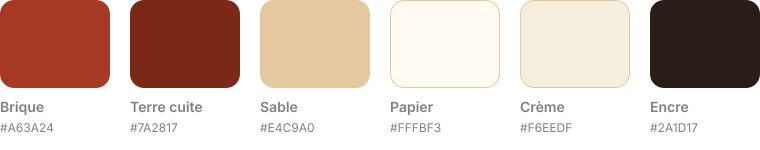

<p align="center">
  
</p>

<h1 align="center">Al Waraqa · الورقة</h1>

<p align="center">Lecteur PDF pour Android. Les pages se tournent au doigt, comme dans un vrai livre.</p>

## Identité visuelle

**Nom.** Al Waraqa (الورقة, « la feuille »). Sur l'écran de démarrage, le nom s'affiche en arabe.

**Icône.** Une feuille au coin plié portant un W, sur fond brique.

**Couleurs**



| Couleur | Code | Usage |
| --- | --- | --- |
| Brique | `#A63A24` | Couleur principale : boutons, icône, splash |
| Terre cuite | `#7A2817` | Brique foncée : ombres du logo, états appuyés |
| Sable | `#E4C9A0` | Coin plié, séparateurs, bordures |
| Papier | `#FFFBF3` | Cartes, barres, feuille du logo |
| Crème | `#F6EEDF` | Fond des écrans |
| Encre | `#2A1D17` | Texte |
| Encre douce | `#6B5547` | Texte secondaire |

**Typographie**

| Rôle | Police |
| --- | --- |
| Titres | Bricolage Grotesque, 700–800 |
| Texte | Police système (Roboto) |
| Nom en arabe | Aref Ruqaa Bold |

**Principes d'interface**

- Pas de bouton flottant : les actions sont dans la mise en page.
- Plusieurs écrans de bienvenue au premier lancement, puis un splash simple.
- Plein écran automatique : les barres du téléphone sont masquées.

## L'application

- 100 % locale, écrite en Kotlin avec Jetpack Compose.
- Rendu des PDF par le moteur intégré d'Android (`PdfRenderer`).
- Mode Livre : la page suit le doigt et se replie comme du papier (`ui/reader/BookPager.kt`).
- Reprise à la dernière page lue.

### Structure

```
app/src/main/java/tn/alwaraqa/app/
├── MainActivity.kt        plein écran, PDF reçu d'une autre app
├── data/Library.kt        documents récents et dernière page lue
├── pdf/PdfDoc.kt          ouverture et rendu des pages
└── ui/
    ├── AlWaraqaApp.kt     enchaînement des écrans
    ├── components/Logo.kt logo dessiné
    ├── reader/BookPager.kt page tournée
    ├── screens/           bienvenue, splash, documents, lecteur
    └── theme/Theme.kt     couleurs et polices
```

### Étapes

1. Ouvrir un PDF et tourner les pages (version actuelle)
2. Bibliothèque et recherche
3. Marque-pages, recherche dans le document, sommaire
4. Réglages, mode nuit, finitions

## Compilation et mises à jour

Chaque envoi sur `main` compile l'APK avec GitHub Actions. L'APK est publié dans les versions du dépôt et sur la branche `apk`.

Les APK sont signés avec une clé de test fixe (`app/alwaraqa-test.keystore`). Une nouvelle version s'installe donc par-dessus la précédente, sans désinstaller ni perdre les données. Pour cela, `versionCode` augmente à chaque version et `applicationId` ne change jamais.

## Licences des polices

Bricolage Grotesque et Aref Ruqaa sont distribuées sous licence SIL Open Font License (voir `licenses/`).
